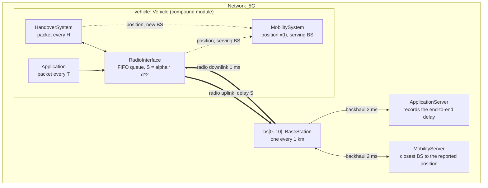
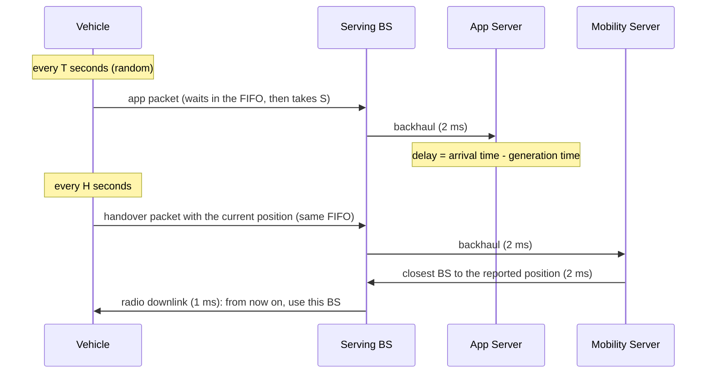

# 5G-Vehicle

Project 3 of Performance Evaluation of Computer Systems and Networks (A.Y. 2026/2027).

A vehicle drives back and forth on a 10 km highway covered by 11 base stations (one every 1 km,
20 m from the road). It sends application packets (one every T seconds, T random) to an
Application Server and, every H seconds, a handover packet with its position to a Mobility Server,
which answers with the closest base station. Both packet types share one FIFO queue, and the
transmission time is S = alpha * d^2, where d is the distance to the serving base station.
We study the end-to-end delay of the application packets for different H, V, E[T] and
distributions of T (exponential and lognormal with the same mean).

What happens to the two kinds of packets:

## Folders

- `VehicleSim/` - OMNeT++ 6 project (can be imported in the OMNeT++ IDE)
  - `src/` - the model: one `.ned` + `.h` + `.cc` per simple module, `Vehicle.ned` (compound module), the two `.msg` files
  - `simulations/` - `Network_5G.ned` (the network) and `omnetpp.ini` (all configurations)
  - `run_all.sh` - builds, runs every configuration and exports the CSV files
- `Analysis/`
  - `analyze_results.ipynb` - statistics and Plotly charts for report sections 7 (experimental design), 8 (results) and 9 (conclusions)
  - `make_highway_gif.py` - animation of one run (`figures/09_highway_animation.gif`)
  - `data/` - CSV files exported by `run_all.sh`; `figures/` - the charts (`.png` for the report, `.html` interactive)
  - `data/old/`, `figures/old/` - data and charts of the earlier version of the simulator (kept for reference)

## How to run

1. Simulations - either:
   - in the OMNeT++ IDE: import `VehicleSim`, build it, run the configs of `simulations/omnetpp.ini`; or
   - in the OMNeT++ shell: `cd VehicleSim` and `./run_all.sh` (all configs, about 5,000 runs, ~30 minutes on 8 cores;
     the CSV files are written to `Analysis/data`)
2. Open `Analysis/analyze_results.ipynb` and run all the cells
3. Optional: `python make_highway_gif.py` in `Analysis/` for the highway animation

Python packages: `plotly kaleido pandas numpy imageio nbformat ipykernel`

## Configurations (`simulations/omnetpp.ini`)

| Config | What | Runs |
|---|---|---|
| `Verification_*` | D/D/1, kinematics (ideal / real handover), degeneracy (alpha = 0, N = 1), consistency, continuity | 1 each (continuity: 5) |
| `Validation_MD1` | M/D/1 against Pollaczek-Khinchine, 4 loads x 30 replications | 120 |
| `Calibration_Warmup` | delay over time from an empty system, to choose the warm-up | 20 |
| `Exp_Exponential`, `Exp_Lognormal` | H x V x E[T] = 4 x 3 x 3 scenarios, 30 replications each, random start position | 1,080 each |
| `Exp_Exponential_x_0`, `Exp_Lognormal_x_0` | the same scenarios with every replication starting at x = 0 (comparison) | 1,080 each |
| `Exp_Ideal_Exponential`, `Exp_Ideal_Lognormal` | ideal handover (lower bound), V x E[T] | 270 each |
| `Exp_ECDF_Exponential`, `Exp_ECDF_Lognormal` | every delay recorded, for the ECDFs | 20 each |
| `Animation` | one run with the serving BS over time, for the GIF | 1 |

## Main results (current campaign)

The experiments start every replication at a random position (`initialPosition = uniform(0m, 10000m)`):
with x = 0 for every run, the handover packets fell exactly on the cell crossings for many (V, H) pairs
(see section 8.7 of the notebook). The same experiments with x = 0 are kept for comparison (section 7.5):
the two agree for H <= 0.1 s, but for H = 5 s (and 3 scenarios with H = 1 s) they differ significantly, in both
directions, and x = 0 hides the congestion collapse. A correlogram shows that the replications are independent
in both experiments, while the packets of one run are strongly correlated (lag-1 autocorrelation 0.99).

- The best handover period is H = 1 s in all 18 combinations of distribution, load and speed.
- Too small H (0.02 s): handover packets overload the queue, mostly at the cell edges where S is largest
  (e.g. E[T] = 10 ms, V = 25 m/s: 261 ms against 13 ms with H = 1 s).
- Too large H (5 s): the vehicle stays on a sub-optimal BS for 4-15 % of the time, more at higher speed.
  At the highest load and speed (E[T] = 7.5 ms, V = 40 m/s) 7-8 of the 30 replications **collapse**: the queue
  grows to tens of thousands of packets, because the handover packets wait in the same queue and the vehicle
  stays on a far BS longer and longer.
- At the best H the delay is 1-5 % (E[T] = 15 ms), 10-26 % (10 ms) and 18-43 % (7.5 ms) above the ideal handover.
- Lognormal T (CoV 2) gives 1.05-2 times the delay of exponential T with the same mean; the difference is all waiting time.

Before submitting the ZIP, remove `out/`, `simulations/results/`, `src/Makefile` and the `*_m.cc` / `*_m.h` files.
