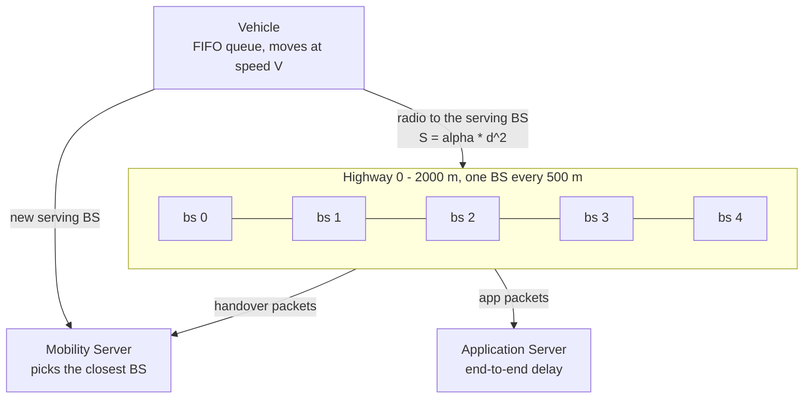
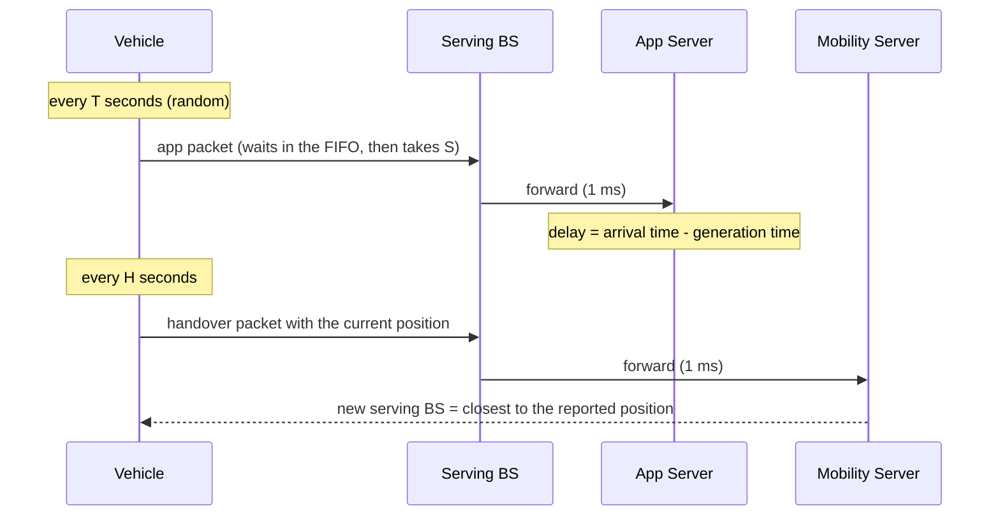

# 5G-Vehicle

Project 3 of Performance Evaluation of Computer Systems and Networks (A.Y. 2026/2027).

A car drives back and forth on a 2 km highway covered by 5 base stations. It sends
application packets (one every T seconds, T random) to an Application Server and,
every H seconds, a handover packet with its position to a Mobility Server, which
picks the closest base station. Both packet types share one FIFO queue and the
transmission time is S = alpha * d^2, where d is the distance to the serving base station.
We study the end-to-end delay of the application packets for different V, T and H.

What happens to the two kinds of packets:

## Folders

- `VehicleSim/` - OMNeT++ 6 model (NED, C++, `omnetpp.ini`) and `run_all.sh`
- `Analysis/` - `analyze_results.ipynb` (statistics and Plotly charts), `make_highway_gif.py`,
  exported CSV data in `data/` and the charts in `figures/`

## How to run

1. In the OMNeT++ shell: `cd VehicleSim` and `./run_all.sh`
   (builds the model, runs all the configurations and exports the CSV files to `Analysis/data`)
2. Open `Analysis/analyze_results.ipynb` and run all the cells
3. Optional: `python make_highway_gif.py` in `Analysis/` for the highway animation

Python packages: `plotly kaleido pandas numpy scipy imageio ipykernel`

## Main results

- The delay as a function of H is U-shaped: best H between about 0.1 and 1 s for all speeds.
- Too small H: handover packets load the transmitter. Too large H: the car keeps using a
  far base station and the queue can collapse (above V*H of about 150-200 m).
- With the same mean and variance, lognormal T gives slightly lower delay than exponential T;
  a higher coefficient of variation of T makes things much worse.

Before submitting the ZIP, remove `out/`, `results/`, the generated `Makefile` and the `*_m.cc` / `*_m.h` files.
